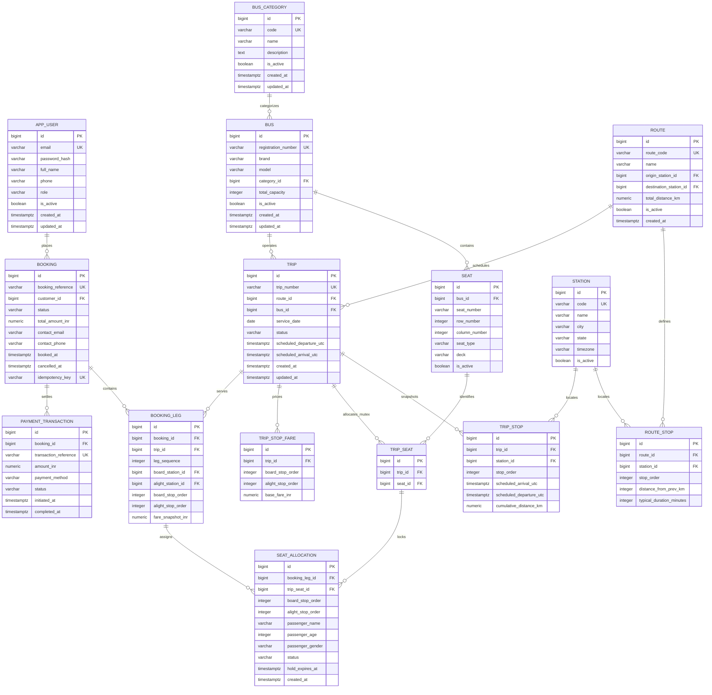

# Database Schema Specification & DDL

**Project:** Full-Stack Bus Ticket Booking Platform  
**Target RDBMS:** PostgreSQL 15+ / 16  
**Migration Framework:** Flyway (`src/main/resources/db/migration/V1__init_schema.sql`)  
**Hibernate Strategy:** `spring.jpa.hibernate.ddl-auto=validate`  

---

## 1. Entity-Relationship Model



---

## 2. Core Relational Constraints & Invariants

1. **Station Non-Repeating Rule on Master Routes:**
   - In MVP, each route stop must reference a distinct station: `UNIQUE (route_id, station_id)`.
   - The ordering within a route must be sequential and gapless: `UNIQUE (route_id, stop_order)`.
2. **TripStop Time Monotonicity:**
   - For every stop $i < j$ in a trip:
     $$\text{stop}_i.departure\_utc \le \text{stop}_j.arrival\_utc < \text{stop}_j.departure\_utc$$
3. **TripSeat Mutex Row Integrity:**
   - There exists exactly one mutex row per seat on a trip: `UNIQUE (trip_id, seat_id)`.
4. **Segment Interval Non-Degeneracy:**
   - Boarding stop order must strictly precede alighting stop order: `CHECK (board_stop_order < alight_stop_order)`.
5. **Interval Overlap Definition:**
   - An allocation $A$ with range $[A_{board}, A_{alight})$ overlaps allocation $B$ with range $[B_{board}, B_{alight})$ if and only if:
     $$A_{board} < B_{alight} \land B_{board} < A_{alight}$$
   - Any overlap between active allocations (`CONFIRMED` or non-expired `HELD`) on the same `trip_seat_id` is rejected with HTTP `409 Conflict`.
6. **Financial Precision:**
   - All fare columns and total amounts use `NUMERIC(10, 2)` (never floating point `FLOAT` or `DOUBLE`).

---

## 3. Flyway Migration Script (`V1__init_schema.sql`)

```sql
-- ============================================================================
-- V1__init_schema.sql: Production Baseline Relational Schema
-- Database: PostgreSQL 15+
-- ============================================================================

CREATE EXTENSION IF NOT EXISTS "uuid-ossp";

-- ----------------------------------------------------------------------------
-- 1. Identity & Access Management
-- ----------------------------------------------------------------------------
CREATE TABLE app_user (
    id BIGSERIAL PRIMARY KEY,
    email VARCHAR(255) NOT NULL,
    password_hash VARCHAR(255) NOT NULL,
    full_name VARCHAR(150) NOT NULL,
    phone VARCHAR(30) NOT NULL,
    role VARCHAR(30) NOT NULL DEFAULT 'ROLE_CUSTOMER',
    is_active BOOLEAN NOT NULL DEFAULT TRUE,
    created_at TIMESTAMPTZ NOT NULL DEFAULT CURRENT_TIMESTAMP,
    updated_at TIMESTAMPTZ NOT NULL DEFAULT CURRENT_TIMESTAMP,
    CONSTRAINT uq_app_user_email UNIQUE (email),
    CONSTRAINT chk_app_user_role CHECK (role IN ('ROLE_CUSTOMER', 'ROLE_ADMIN'))
);

CREATE INDEX idx_app_user_email ON app_user(email);

-- ----------------------------------------------------------------------------
-- 2. Bus Catalog & Seats
-- ----------------------------------------------------------------------------
CREATE TABLE bus_category (
    id BIGSERIAL PRIMARY KEY,
    code VARCHAR(50) NOT NULL,
    name VARCHAR(100) NOT NULL,
    description TEXT,
    is_active BOOLEAN NOT NULL DEFAULT TRUE,
    created_at TIMESTAMPTZ NOT NULL DEFAULT CURRENT_TIMESTAMP,
    updated_at TIMESTAMPTZ NOT NULL DEFAULT CURRENT_TIMESTAMP,
    CONSTRAINT uq_bus_category_code UNIQUE (code)
);

CREATE TABLE bus (
    id BIGSERIAL PRIMARY KEY,
    registration_number VARCHAR(50) NOT NULL,
    brand VARCHAR(100) NOT NULL,
    model VARCHAR(100) NOT NULL,
    category_id BIGINT NOT NULL,
    total_capacity INT NOT NULL,
    is_active BOOLEAN NOT NULL DEFAULT TRUE,
    created_at TIMESTAMPTZ NOT NULL DEFAULT CURRENT_TIMESTAMP,
    updated_at TIMESTAMPTZ NOT NULL DEFAULT CURRENT_TIMESTAMP,
    CONSTRAINT uq_bus_registration UNIQUE (registration_number),
    CONSTRAINT fk_bus_category FOREIGN KEY (category_id) 
        REFERENCES bus_category(id) ON DELETE RESTRICT,
    CONSTRAINT chk_bus_capacity CHECK (total_capacity > 0 AND total_capacity <= 80)
);

CREATE INDEX idx_bus_category ON bus(category_id);

CREATE TABLE seat (
    id BIGSERIAL PRIMARY KEY,
    bus_id BIGINT NOT NULL,
    seat_number VARCHAR(10) NOT NULL,
    row_number INT NOT NULL,
    column_number INT NOT NULL,
    seat_type VARCHAR(30) NOT NULL DEFAULT 'SEATER', -- SEATER, SLEEPER, SEMI_SLEEPER
    deck VARCHAR(20) NOT NULL DEFAULT 'LOWER',       -- LOWER, UPPER
    is_active BOOLEAN NOT NULL DEFAULT TRUE,
    CONSTRAINT uq_bus_seat UNIQUE (bus_id, seat_number),
    CONSTRAINT fk_seat_bus FOREIGN KEY (bus_id) 
        REFERENCES bus(id) ON DELETE CASCADE,
    CONSTRAINT chk_seat_row CHECK (row_number >= 1),
    CONSTRAINT chk_seat_col CHECK (column_number >= 1)
);

CREATE INDEX idx_seat_bus ON seat(bus_id);

-- ----------------------------------------------------------------------------
-- 3. Stations, Routes and Route Stops
-- ----------------------------------------------------------------------------
CREATE TABLE station (
    id BIGSERIAL PRIMARY KEY,
    code VARCHAR(20) NOT NULL,
    name VARCHAR(150) NOT NULL,
    city VARCHAR(100) NOT NULL,
    state VARCHAR(100) NOT NULL,
    timezone VARCHAR(50) NOT NULL DEFAULT 'Asia/Kolkata',
    is_active BOOLEAN NOT NULL DEFAULT TRUE,
    CONSTRAINT uq_station_code UNIQUE (code)
);

CREATE INDEX idx_station_city ON station(city);

CREATE TABLE route (
    id BIGSERIAL PRIMARY KEY,
    route_code VARCHAR(50) NOT NULL,
    name VARCHAR(200) NOT NULL,
    origin_station_id BIGINT NOT NULL,
    destination_station_id BIGINT NOT NULL,
    total_distance_km NUMERIC(8, 2) NOT NULL DEFAULT 0.00,
    is_active BOOLEAN NOT NULL DEFAULT TRUE,
    created_at TIMESTAMPTZ NOT NULL DEFAULT CURRENT_TIMESTAMP,
    CONSTRAINT uq_route_code UNIQUE (route_code),
    CONSTRAINT fk_route_origin FOREIGN KEY (origin_station_id) 
        REFERENCES station(id) ON DELETE RESTRICT,
    CONSTRAINT fk_route_destination FOREIGN KEY (destination_station_id) 
        REFERENCES station(id) ON DELETE RESTRICT,
    CONSTRAINT chk_route_distinct_terminals CHECK (origin_station_id <> destination_station_id)
);

CREATE TABLE route_stop (
    id BIGSERIAL PRIMARY KEY,
    route_id BIGINT NOT NULL,
    station_id BIGINT NOT NULL,
    stop_order INT NOT NULL,
    distance_from_prev_km NUMERIC(8, 2) NOT NULL DEFAULT 0.00,
    typical_duration_minutes INT NOT NULL DEFAULT 0,
    CONSTRAINT uq_route_stop_order UNIQUE (route_id, stop_order),
    CONSTRAINT uq_route_stop_station UNIQUE (route_id, station_id),
    CONSTRAINT fk_route_stop_route FOREIGN KEY (route_id) 
        REFERENCES route(id) ON DELETE CASCADE,
    CONSTRAINT fk_route_stop_station FOREIGN KEY (station_id) 
        REFERENCES station(id) ON DELETE RESTRICT,
    CONSTRAINT chk_stop_order_nonnegative CHECK (stop_order >= 0)
);

CREATE INDEX idx_route_stop_search ON route_stop(station_id, route_id);

-- ----------------------------------------------------------------------------
-- 4. Trips, Immutable Snapshots, Fares & Mutex Rows
-- ----------------------------------------------------------------------------
CREATE TABLE trip (
    id BIGSERIAL PRIMARY KEY,
    trip_number VARCHAR(50) NOT NULL,
    route_id BIGINT NOT NULL,
    bus_id BIGINT NOT NULL,
    service_date DATE NOT NULL,
    status VARCHAR(30) NOT NULL DEFAULT 'SCHEDULED', -- SCHEDULED, IN_PROGRESS, COMPLETED, CANCELLED
    scheduled_departure_utc TIMESTAMPTZ NOT NULL,
    scheduled_arrival_utc TIMESTAMPTZ NOT NULL,
    created_at TIMESTAMPTZ NOT NULL DEFAULT CURRENT_TIMESTAMP,
    updated_at TIMESTAMPTZ NOT NULL DEFAULT CURRENT_TIMESTAMP,
    CONSTRAINT uq_trip_number UNIQUE (trip_number),
    CONSTRAINT fk_trip_route FOREIGN KEY (route_id) 
        REFERENCES route(id) ON DELETE RESTRICT,
    CONSTRAINT fk_trip_bus FOREIGN KEY (bus_id) 
        REFERENCES bus(id) ON DELETE RESTRICT,
    CONSTRAINT chk_trip_times CHECK (scheduled_departure_utc < scheduled_arrival_utc)
);

CREATE INDEX idx_trip_search ON trip(service_date, status);
CREATE INDEX idx_trip_route ON trip(route_id);

CREATE TABLE trip_stop (
    id BIGSERIAL PRIMARY KEY,
    trip_id BIGINT NOT NULL,
    station_id BIGINT NOT NULL,
    stop_order INT NOT NULL,
    scheduled_arrival_utc TIMESTAMPTZ,
    scheduled_departure_utc TIMESTAMPTZ,
    cumulative_distance_km NUMERIC(8, 2) NOT NULL DEFAULT 0.00,
    CONSTRAINT uq_trip_stop_order UNIQUE (trip_id, stop_order),
    CONSTRAINT fk_trip_stop_trip FOREIGN KEY (trip_id) 
        REFERENCES trip(id) ON DELETE CASCADE,
    CONSTRAINT fk_trip_stop_station FOREIGN KEY (station_id) 
        REFERENCES station(id) ON DELETE RESTRICT,
    CONSTRAINT chk_trip_stop_order CHECK (stop_order >= 0)
);

CREATE INDEX idx_trip_stop_lookup ON trip_stop(station_id, scheduled_departure_utc);
CREATE INDEX idx_trip_stop_trip ON trip_stop(trip_id);

CREATE TABLE trip_stop_fare (
    id BIGSERIAL PRIMARY KEY,
    trip_id BIGINT NOT NULL,
    board_stop_order INT NOT NULL,
    alight_stop_order INT NOT NULL,
    base_fare_inr NUMERIC(10, 2) NOT NULL,
    CONSTRAINT uq_trip_stop_fare UNIQUE (trip_id, board_stop_order, alight_stop_order),
    CONSTRAINT fk_trip_stop_fare_trip FOREIGN KEY (trip_id) 
        REFERENCES trip(id) ON DELETE CASCADE,
    CONSTRAINT chk_trip_fare_order CHECK (board_stop_order < alight_stop_order),
    CONSTRAINT chk_trip_fare_positive CHECK (base_fare_inr >= 0)
);

CREATE TABLE trip_seat (
    id BIGSERIAL PRIMARY KEY,
    trip_id BIGINT NOT NULL,
    seat_id BIGINT NOT NULL,
    CONSTRAINT uq_trip_seat UNIQUE (trip_id, seat_id),
    CONSTRAINT fk_trip_seat_trip FOREIGN KEY (trip_id) 
        REFERENCES trip(id) ON DELETE CASCADE,
    CONSTRAINT fk_trip_seat_seat FOREIGN KEY (seat_id) 
        REFERENCES seat(id) ON DELETE RESTRICT
);

CREATE INDEX idx_trip_seat_lookup ON trip_seat(trip_id, seat_id);

-- ----------------------------------------------------------------------------
-- 5. Bookings, Legs & Interval Allocations
-- ----------------------------------------------------------------------------
CREATE TABLE booking (
    id BIGSERIAL PRIMARY KEY,
    booking_reference VARCHAR(64) NOT NULL,
    customer_id BIGINT NOT NULL,
    status VARCHAR(30) NOT NULL DEFAULT 'CONFIRMED', -- CONFIRMED, PAYMENT_PENDING, CANCELLED
    total_amount_inr NUMERIC(10, 2) NOT NULL,
    contact_email VARCHAR(255) NOT NULL,
    contact_phone VARCHAR(30) NOT NULL,
    booked_at TIMESTAMPTZ NOT NULL DEFAULT CURRENT_TIMESTAMP,
    cancelled_at TIMESTAMPTZ,
    idempotency_key VARCHAR(100),
    CONSTRAINT uq_booking_reference UNIQUE (booking_reference),
    CONSTRAINT uq_booking_idempotency UNIQUE (idempotency_key),
    CONSTRAINT fk_booking_customer FOREIGN KEY (customer_id) 
        REFERENCES app_user(id) ON DELETE RESTRICT,
    CONSTRAINT chk_booking_total_positive CHECK (total_amount_inr >= 0)
);

CREATE INDEX idx_booking_customer ON booking(customer_id);
CREATE INDEX idx_booking_reference ON booking(booking_reference);

CREATE TABLE booking_leg (
    id BIGSERIAL PRIMARY KEY,
    booking_id BIGINT NOT NULL,
    trip_id BIGINT NOT NULL,
    leg_sequence INT NOT NULL DEFAULT 1, -- 1 for direct, 1 & 2 for connecting
    board_station_id BIGINT NOT NULL,
    alight_station_id BIGINT NOT NULL,
    board_stop_order INT NOT NULL,
    alight_stop_order INT NOT NULL,
    fare_snapshot_inr NUMERIC(10, 2) NOT NULL,
    CONSTRAINT uq_booking_leg_sequence UNIQUE (booking_id, leg_sequence),
    CONSTRAINT fk_booking_leg_booking FOREIGN KEY (booking_id) 
        REFERENCES booking(id) ON DELETE CASCADE,
    CONSTRAINT fk_booking_leg_trip FOREIGN KEY (trip_id) 
        REFERENCES trip(id) ON DELETE RESTRICT,
    CONSTRAINT fk_booking_leg_board_station FOREIGN KEY (board_station_id) 
        REFERENCES station(id) ON DELETE RESTRICT,
    CONSTRAINT fk_booking_leg_alight_station FOREIGN KEY (alight_station_id) 
        REFERENCES station(id) ON DELETE RESTRICT,
    CONSTRAINT chk_booking_leg_order CHECK (board_stop_order < alight_stop_order)
);

CREATE INDEX idx_booking_leg_booking ON booking_leg(booking_id);
CREATE INDEX idx_booking_leg_trip ON booking_leg(trip_id);

CREATE TABLE seat_allocation (
    id BIGSERIAL PRIMARY KEY,
    booking_leg_id BIGINT NOT NULL,
    trip_seat_id BIGINT NOT NULL,
    board_stop_order INT NOT NULL,
    alight_stop_order INT NOT NULL,
    passenger_name VARCHAR(150) NOT NULL,
    passenger_age INT NOT NULL,
    passenger_gender VARCHAR(20) NOT NULL,
    status VARCHAR(30) NOT NULL DEFAULT 'CONFIRMED', -- HELD, CONFIRMED, CANCELLED, EXPIRED
    hold_expires_at TIMESTAMPTZ,
    created_at TIMESTAMPTZ NOT NULL DEFAULT CURRENT_TIMESTAMP,
    CONSTRAINT fk_allocation_leg FOREIGN KEY (booking_leg_id) 
        REFERENCES booking_leg(id) ON DELETE CASCADE,
    CONSTRAINT fk_allocation_trip_seat FOREIGN KEY (trip_seat_id) 
        REFERENCES trip_seat(id) ON DELETE RESTRICT,
    CONSTRAINT chk_allocation_stop_order CHECK (board_stop_order < alight_stop_order),
    CONSTRAINT chk_passenger_age CHECK (passenger_age >= 0 AND passenger_age <= 125)
);

-- Index to optimize interval overlap query under row lock
CREATE INDEX idx_allocation_active ON seat_allocation(trip_seat_id, status)
    WHERE status IN ('CONFIRMED', 'HELD');

-- ----------------------------------------------------------------------------
-- 6. P1 Mock Payment & Transactions (Schema Preparedness)
-- ----------------------------------------------------------------------------
CREATE TABLE payment_transaction (
    id BIGSERIAL PRIMARY KEY,
    booking_id BIGINT NOT NULL,
    transaction_reference VARCHAR(100) NOT NULL,
    amount_inr NUMERIC(10, 2) NOT NULL,
    payment_method VARCHAR(50) NOT NULL DEFAULT 'SIMULATED_UPI',
    status VARCHAR(30) NOT NULL DEFAULT 'INITIATED', -- INITIATED, SUCCESS, FAILED
    initiated_at TIMESTAMPTZ NOT NULL DEFAULT CURRENT_TIMESTAMP,
    completed_at TIMESTAMPTZ,
    CONSTRAINT uq_payment_reference UNIQUE (transaction_reference),
    CONSTRAINT fk_payment_booking FOREIGN KEY (booking_id) 
        REFERENCES booking(id) ON DELETE RESTRICT
);

CREATE INDEX idx_payment_booking ON payment_transaction(booking_id);
```

---

## 4. Query Patterns & Index Justification

1. **Direct Search Query:**
   - Filters `trip_stop ts_board` and `trip_stop ts_alight` where `ts_board.trip_id = ts_alight.trip_id` and `ts_board.station_id = :orig` and `ts_alight.station_id = :dest` and `ts_board.stop_order < ts_alight.stop_order`.
   - Index `idx_trip_stop_lookup ON trip_stop(station_id, scheduled_departure_utc)` allows index scans on boarding station and departure time window.
2. **Interval Overlap Validation Query:**
   - Evaluated under pessimistic lock on `trip_seat.id`:
     ```sql
     SELECT COUNT(*) FROM seat_allocation
     WHERE trip_seat_id = :tripSeatId
       AND status IN ('CONFIRMED', 'HELD')
       AND (board_stop_order < :requestedAlightOrder AND alight_stop_order > :requestedBoardOrder);
     ```
   - Partial composite index `idx_allocation_active ON seat_allocation(trip_seat_id, status)` ensures $O(\log k)$ index lookups where $k$ is active allocations per seat.
