# Implementation Plan & Architectural Decision Records (ADRs)

**Project:** Full-Stack Bus Ticket Booking Platform  
**Target Horizon:** 15-Day Delivery Plan (Modular Monolith)  
**Baseline Specification:** `docs/reference/BusTicketBookingApp_Spec.pdf` (Saras Sir, Java Training School)  
**Approved Overlay:** `docs/engineering-spec.md`, `docs/acceptance-tests.md`, `docs/delivery-plan.md`, `AGENTS.md`  
**Status:** APPROVED & IMPLEMENTED (All P0/P1 Slices & Acceptance Tests R01–R20 Verified)

---

## 1. Executive Feasibility & Consistency Audit

A thorough, read-only analysis of the mandatory PDF baseline and engineering specifications was conducted. Below are the key findings across all core technical domains:

| Domain | Findings & Feasibility Assessment | Alignment with PDF Baseline |
|---|---|---|
| **Entity Model** | The PDF defines 6 core entities: `Customer`, `BusCategory`, `Bus / Vehicle`, `Station`, `BusSchedule / Trip`, `Booking / Ticket`. The engineering spec refines this into normalized tables: `Bus`, `Seat`, `Station`, `Route`, `RouteStop`, `Trip`, `TripStop`, `TripSeat`, `Booking`, `BookingLeg`, `SeatAllocation`. This satisfies the PDF's requirement that *"The following tables are recommended as a starting point; additional tables may be added as required."* | Fully consistent. All PDF entities are represented. |
| **Overlapping Segment Locking** | Buses traverse ordered stations $0, 1, \dots, n-1$. A seat reservation over $[boardIndex, alightIndex)$ uses a half-open interval. Two bookings overlap iff $A_{board} < B_{alight} \land B_{board} < A_{alight}$. A dedicated mutex entity `TripSeat` $(trip\_id, seat\_id)$ locked with `PESSIMISTIC_WRITE` (`SELECT FOR UPDATE`) serializes reservation attempts per seat. | Exceeds PDF requirements by preventing overbooking while permitting resale of non-overlapping legs on the same bus trip. |
| **Multi-Leg Transaction** | Connecting journeys (1 transfer, 2 legs) require all-or-nothing seat allocations across two distinct trips. Spring `@Transactional` with row locks acquired on `TripSeat` in deterministic order $(trip\_id, seat\_id)$ eliminates deadlocks. If Leg 2 fails, the entire transaction rolls back cleanly with 0 active allocations. | Fulfills the PDF requirement: *"If a direct bus is not allowed, show them all the connecting routes"* and booking availability guarantees. |
| **Route-Search Time Semantics** | Search requires departure station, destination station, travel date, and departure time window. Stations operate in Indian Standard Time (`Asia/Kolkata`, UTC+05:30). Departure windows are evaluated against the scheduled departure at the origin boarding station in station local time. Timestamps are persisted in PostgreSQL as `TIMESTAMPTZ` (UTC). Connecting itineraries enforce a 30-minute minimum and 8-hour maximum layover. Cross-midnight transfers are supported. | Fully compliant with PDF Section 3.2. |
| **Auth, Session & CSRF** | Spring Security 6 session-based authentication using HTTP-only, SameSite cookies (`JSESSIONID`). Double-submit / cookie-backed CSRF protection (`XSRF-TOKEN` cookie, `X-XSRF-TOKEN` header) for all mutating endpoints (`POST`, `PUT`, `DELETE`). Server-side ownership checks ensure customers can only access and cancel their own bookings. Passwords hashed using BCrypt. | Satisfies Customer Registration/Login and role separation. |
| **Flyway Migrations** | Hibernate `ddl-auto` is set to `validate`. Versioned Flyway migrations (`V1__init_schema.sql`, `V2__seed_reference_data.sql`) ensure idempotent schema rollouts and repeatable test setups across environments. | Complies with workspace and PostgreSQL guidelines. |
| **Milestone Dependencies** | The 15-day delivery plan establishes a strict DAG (Directed Acyclic Graph): Schema/ADRs (D1) $\to$ Scaffold/Flyway (D2) $\to$ Auth/Categories (D3) $\to$ Buses/Routes (D4) $\to$ Trips/Fares/Mutex (D5) $\to$ Search (D6-D7) $\to$ Atomic Booking (D8) $\to$ Concurrency Tests (D9) $\to$ Lifecycle/Cancellation (D10) $\to$ Customer UI (D11) $\to$ Admin UI (D12) $\to$ P1 Holds/Payment (D13) $\to$ Hardening (D14) $\to$ Freeze (D15). | Fully unblocked and viable. |

---

## 2. PDF Conflicts, Ambiguities & Approved Resolutions

### Issue 1: Category, Bus, Route & Trip Deletion vs. Referential Integrity
* **PDF Requirement (Page 1):** *"Administrators should be able to perform Create, Read, Update and Delete (CRUD) operations for... Bus Categories [and] Buses."*
* **Architectural Conflict:** In a relational database, deleting a category, bus, station, route, or scheduled trip referenced by scheduled trips or customer bookings will either violate foreign key constraints (`RESTRICT`) or cause catastrophic cascading data loss (`CASCADE`).
* **Approved Decision (ADR-06):**
  1. Provide standard `DELETE /api/v1/admin/{categories|buses|stations|routes|trips}/{id}` endpoints.
  2. If the entity has **no** historical or downstream references (e.g., no buses for a category, no trips for a bus/route, or no booking legs for a trip), execute a hard delete (`204 No Content`).
  3. If the entity has active references (such as a `Trip` referenced by `booking_leg`), reject the hard delete with HTTP `409 Conflict` (`ProblemDetail` specifying active dependencies) and automatically apply a reference-safe soft status transition (`is_active = false` for catalog entities, or `status = CANCELLED` for scheduled trips via `@Transactional(noRollbackFor = ResourceConflictException.class)`), preserving historical and financial audit integrity.

### Issue 2: "If a direct bus is not allowed, show them all the connecting routes"
* **PDF Requirement (Page 2):** *"If a direct bus is not allowed, show them all the connecting routes."*
* **Ambiguity:** What triggers connecting route search?
* **Approved Decision (ADR-03):** When a search for a direct journey between origin and destination on the requested date and departure window returns **0 direct trips**, the search engine automatically queries connecting itineraries with exactly 1 transfer station, layover between 30 minutes and 8 hours, and seat availability on both legs. Both legs are returned aggregated under a connecting journey option.

### Issue 3: Java Exception Hierarchy
* **PDF Requirement (Page 2-3):** Explicitly specifies:
  * `CustomerNotFoundException`
  * `BusNotFoundException`
  * `BusCategoryNotFoundException`
* **Approved Decision (ADR-08):** These exact class names will be created and inherit from a common `ResourceNotFoundException`. They will be caught by `@RestControllerAdvice` and rendered as RFC 9457 `ProblemDetail` responses with status `404 Not Found`.

---

## 3. Architecture Decision Records (ADRs)

### ADR-01: Modular Monolith Architecture
* **Context:** The application requires high transactional integrity (multi-leg booking, mutex locking) and rapid delivery within 15 days.
* **Decision:** Build a modular monolith using Java 17 / Spring Boot 3.3.4 and React 18 (Vite 5). Package by feature (`auth`, `category`, `bus`, `station`, `route`, `trip`, `journey`, `booking`, `common`). Prohibit microservices, Kafka, and distributed consensus mechanisms.
* **Consequences:** Low operational complexity, direct ACID database transactions, rapid local setup with either Zero-Config H2 (`local` profile) or PostgreSQL (`default` profile via Docker Compose or native service).

### ADR-02: Relational Interval Model & Mutex Locking for Seat Availability
* **Context:** A bus makes multiple stops. A single physical seat may be booked between Stop 0 and Stop 1, and booked by a different passenger between Stop 1 and Stop 3. A naive boolean `is_booked` column on a seat fails for partial-route bookings.
* **Decision:**
  1. A scheduled `Trip` has ordered `TripStop` records indexed $0 \dots n-1$.
  2. Each segment booking is stored in `seat_allocation` with a half-open interval $[board\_index, alight\_index)$.
  3. Two intervals overlap if and only if:
     $$\text{overlap} = (A_{board} < B_{alight}) \land (B_{board} < A_{alight})$$
  4. To guarantee concurrency safety under high load (Test R08: 20 concurrent requests for the same seat/segment), each $(trip\_id, seat\_id)$ has a row in `trip_seat`.
  5. The booking transaction executes:
     ```sql
     SELECT id FROM trip_seat 
     WHERE trip_id = :tripId AND seat_id = :seatId 
     FOR UPDATE;
     ```
     followed by querying active allocations for overlaps.
* **Consequences:** Eliminates phantom reads and race conditions. Maximizes seat utilization and resale over disjoint segments.

### ADR-03: Multi-Leg Connecting Route Atomic Booking Transaction
* **Context:** A connecting journey consists of Leg 1 (Trip A, Station X $\to$ Station Y) and Leg 2 (Trip B, Station Y $\to$ Station Z).
* **Decision:**
  1. Connecting bookings are captured in a single `Booking` parent entity with two `BookingLeg` children.
  2. All requested `TripSeat` mutex rows across all legs are acquired in sorted order:
     $$\text{ORDER BY } trip\_id \text{ ASC}, seat\_id \text{ ASC}$$
     This global ordering strictly prevents cyclic wait-for deadlocks between concurrent connecting bookings.
  3. The entire operation runs inside `@Transactional(isolation = Isolation.READ_COMMITTED)`.
  4. If any leg fails availability validation, a `SeatUnavailableException` is thrown, rolling back all leg allocations. Zero active allocations remain (Acceptance Test R10).
* **Consequences:** Guarantees absolute itinerary consistency; a passenger will never be partially booked on an orphaned leg.

### ADR-04: Departure Time Window & Station Timezone Semantics
* **Context:** The PDF specifies search by departure station, destination station, travel date, and time window.
* **Decision:**
  1. All database timestamps are stored in UTC as `TIMESTAMPTZ`.
  2. All MVP stations are situated in India (`Asia/Kolkata`, UTC+05:30).
  3. The `travelDate` (e.g. `2026-11-01`) and `timeWindow` (`06:00` to `12:00`) apply to the scheduled departure time at the *boarding station* in `Asia/Kolkata`.
  4. The search query converts the local date and time window into UTC boundaries and queries the indexed `departure_time` of the boarding `TripStop`.
* **Consequences:** Consistent handling of cross-midnight trips and reliable ISO 8601 offset formatting in the REST API.

### ADR-05: Session-Based Cookie Authentication & Double-Submit CSRF
* **Context:** The platform requires secure customer and administrator authentication without storing sensitive credentials in browser local storage.
* **Decision:**
  1. Use Spring Security 6 session-based authentication.
  2. The session identifier is stored in a cookie (`JSESSIONID`) with `HttpOnly = true`, `SameSite = Lax` (or `Strict`), and `Path = /api`.
  3. CSRF protection is enforced for all state-changing endpoints (`POST`, `PUT`, `DELETE`, `PATCH`) using Spring's `CookieCsrfTokenRepository.withHttpOnlyFalse()`. The React UI reads the `XSRF-TOKEN` cookie and attaches the `X-XSRF-TOKEN` header.
  4. Server-side role checks: `/api/v1/admin/**` requires `ROLE_ADMIN`; `/api/v1/me/**` requires authenticated user; `/api/v1/bookings/{id}` verifies authenticated user owns the booking or is an admin.
* **Consequences:** Resistant to XSS credential theft and CSRF attacks.

### ADR-06: Reference-Safe Deletion and Master-Trip Immutability
* **Context:** Admin modifications to master routes, buses, categories, or scheduled trips must not corrupt or alter historical trips and confirmed customer bookings.
* **Decision:**
  1. Master `Route` and `RouteStop` entities define route templates. When an admin schedules a `Trip`, immutable `TripStop` and `TripStopFare` snapshots are created for that trip.
  2. Master entities referenced by any scheduled or past `Trip` (or a `Trip` referenced by any `BookingLeg`) cannot be hard deleted. Deletion endpoints transition the entity to a soft-deactivated/cancelled state (`is_active = false` or `status = CANCELLED`) and return HTTP `409 Conflict` explaining that the record had active references and was soft-deactivated instead.
  3. Unreferenced entities are hard-deleted cleanly (`204 No Content`).
* **Consequences:** Complete auditability, zero foreign-key crashes, and preserved financial/booking history.

### ADR-07: Java Toolchain & Runtime Compatibility
* **Context:** `AGENTS.md` notes Java 21, while the current environment runtime provides OpenLogic OpenJDK 17.0.20. Spring Boot 3.3.x/3.4.x natively supports both Java 17 and Java 21.
* **Decision:** Configure Maven `pom.xml` with `<java.version>17</java.version>` (or dynamically configured compiler target) to ensure immediate out-of-the-box buildability and test execution in the local environment, with full forwards compatibility with Java 21 LTS features.
* **Consequences:** No friction with host JDK while maintaining Spring Boot 3 standards.

### ADR-08: RFC 9457 ProblemDetail Unified Error Handling
* **Context:** Consistent API error communication is required across all failure scenarios (validation, missing entities, concurrency conflicts, unauthorized access).
* **Decision:** Use Spring 6's standard `ProblemDetail` specification (RFC 9457). Every error response includes `type`, `title`, `status`, `detail`, `instance`, `code`, and optional `errors` (for field-level validation).
* **Consequences:** Eliminates leaked stack traces; provides clear, machine-readable errors for frontend state management.

---

## 4. Priority Classification (P0 / P1 / Deferred)

```mermaid
flowchart TD
    subgraph P0["Committed P0 (Days 1 - 12)"]
        P0_1["Admin Category CRUD (Soft/Ref-safe)"]
        P0_2["Bus CRUD & Seat Layout Generation"]
        P0_3["Stations, Routes & Trip Scheduling"]
        P0_4["Customer Auth & Profile Management"]
        P0_5["Direct Search with Intermediate Stops"]
        P0_6["Connecting Search (1 transfer, 30m-8h layover)"]
        P0_7["Pessimistic Mutex Seat Locking & Overlap Validation"]
        P0_8["Atomic Multi-Leg Booking & Whole-Itinerary Cancel"]
        P0_9["Printable Ticket & Booking History"]
        P0_10["Unit, PostgreSQL Integration & Concurrency Tests"]
        P0_11["Full Customer & Admin React UI"]
    end

    subgraph P1["Committed P1 (Day 13 - Only if P0 Green)"]
        P1_1["10-Minute Seat Holds (Status: HELD)"]
        P1_2["Background Expiry Sweeper (Scheduled)"]
        P1_3["Simulated Mock Payment Flow (Idempotent)"]
        P1_4["Admin Occupancy & Revenue Analytics"]
        P1_5["Ticket QR Code & Email Outbox Preview"]
    end

    subgraph Deferred["Deferred (Strictly Prohibited for MVP)"]
        D_1["Real Payment Gateways (Stripe, Razorpay)"]
        D_2["Live Vehicle GPS Tracking"]
        D_3["Multi-Transfer Journeys (> 1 Layover)"]
        D_4["Dynamic Pricing Algorithms & Coupons"]
        D_5["Kafka / Redis Distributed Infrastructure"]
        D_6["SMS Gateways / Native Mobile Apps"]
    end

    P0 --> P1
    P1 -.-> Deferred
```



---

## 5. Day-by-Day Implementation Delivery Plan (D1 – D15)

| Day | Milestone & Slice | Deliverables & Work Items | Verification Gate & Acceptance Criteria |
|---|---|---|---|
| **D1** | **Architecture, Schema & Plan Approval** | Feasibility audit, ADRs, Traceability Matrix, PostgreSQL DDL schema with indexes/constraints, OpenAPI 3.0 draft, Test Mapping. | Plan approved by User. All PDF requirements mapped to concrete components. |
| **D2** | **Project Scaffold & Toolchain** | Maven multi-module or standard monolith structure; Spring Boot 3.x dependencies; React Vite frontend scaffold; Docker Compose for PostgreSQL; Flyway migration setup; Health check endpoints (`/actuator/health`). | `mvn clean test` compiles cleanly; Flyway connects to PostgreSQL; Frontend `npm run build` succeeds; Health endpoint returns `{"status":"UP"}`. |
| **D3** | **Auth, RBAC & Category CRUD** | Spring Security session configuration; CSRF cookie handler; User entity & repository; BCrypt password hashing; Auth controller (`/register`, `/login`, `/logout`, `/me`); Category entity, repository, service, controller (`/api/v1/categories`, `/api/v1/admin/categories`). | Acceptance Tests **R01**, **R04**. Unauthorized users denied admin access (401/403). Session cookie issued and validated. |
| **D4** | **Buses, Seats, Stations & Routes** | Bus & Seat entities; Seat generation logic based on capacity; Station entity; Route and ordered RouteStop entities with position uniqueness and station non-repeat validation; Admin CRUD controllers. | Acceptance Tests **R02**, **R03** (part 1). Bus registration uniqueness enforced; reference-safe delete validated. |
| **D5** | **Trip Scheduling, Snapshots & Mutex Rows** | Trip & TripStop entities; snapshot departure/arrival timestamps from route template; Fare segment table; `TripSeat` mutex table generation upon trip creation; Admin trip schedule controller. | Acceptance Tests **R03** (part 2). Strictly increasing departure times verified; mutex rows automatically populated. |
| **D6** | **Direct Journey Search** | Direct journey search query using indexed `TripStop` pairs ($boardIndex < alightIndex$); local time window filtering (`Asia/Kolkata`); seat availability calculation via disjoint interval check; fare calculation. | Acceptance Test **R05**. Search returns valid trips with accurate prices and available seat counts. Intermediate stop pairs correctly resolved. |
| **D7** | **Connecting Journey Search** | Connecting search query when direct returns 0 results; single transfer point matching ($Leg1_{dest} == Leg2_{orig}$); layover constraint ($30 \le \Delta t \le 480$ minutes); aggregate pricing. | Acceptance Test **R09**. Returns time-feasible 1-transfer connections; rejects impossible or tight connections (<30m). |
| **D8** | **Transactional Booking & Multi-Leg Allocation** | Single-leg and multi-leg booking service; row-level mutex locking on `TripSeat` ordered by $(tripId, seatId)$; interval overlap validation; atomic leg insertion; ticket generation with fare snapshots. | Acceptance Tests **R06**, **R07**, **R10**, **R12**. Disjoint intervals succeed; multi-leg atomic rollback verified on second leg failure. |
| **D9** | **Concurrency & Idempotency Stress Testing** | Concurrent booking test using Java `ExecutorService` and `CountDownLatch` (20 concurrent threads attempting the exact same seat and segment); idempotency key header deduplication. | Acceptance Tests **R08**, **R15**. Exactly 1 booking succeeds; 19 receive HTTP 409 Conflict; exactly 1 active DB allocation exists. |
| **D10** | **Booking Cancellation, History & Tickets** | Whole-itinerary cancellation; status transition `CONFIRMED -> CANCELLED`; seat allocation release; customer booking history (`/api/v1/me/bookings`); printable ticket endpoint (`/api/v1/bookings/{id}`). | Acceptance Tests **R11**, **R14**. Customer cannot cancel or view other users' bookings; repeated cancellation idempotent. |
| **D11** | **Customer React Frontend** | Responsive customer journey: Search form $\to$ Direct & Connecting Results $\to$ Visual Seat Map $\to$ Passenger Details $\to$ Booking Confirmation $\to$ Printable Ticket View $\to$ Booking History & Cancellation. | Acceptance Tests **R16**, **R17**. Complete customer booking path operational with loading, error, and conflict states. |
| **D12** | **Admin React Frontend** | Admin management interface: Category CRUD, Bus CRUD, Station & Route builder, Trip Scheduler with calendar, Occupancy overview, Error modals. | Admin CRUD operational; form validation prevents invalid submissions. |
| **D13** | **P1 Seat Holds & Mock Payment Sweeper** *(Gated)* | **Only executed if D1-D12 are 100% green.** 10-minute hold status (`HELD`); scheduled background task expiring stale holds; simulated payment mock endpoint; idempotent payment webhook. | Acceptance Tests **R18**, **R19**. Stale holds automatically released; duplicate payment calls handled idempotently. |
| **D14** | **Observability, Hardening & Security Audit** | Structured JSON logging with MDC `requestId`; PII redaction (passwords, phone); RFC 9457 exception handler validation; responsive UI accessibility checks; automated test regression run. | Acceptance Test **R13**. Clean error responses, no stack traces leaked; test suite passes without regressions. |
| **D15** | **Clean-Machine Rehearsal, Demo Seed & Freeze** | Clean checkout rehearsal; seed dataset script (6 stations, 3 buses, 2 routes, 8 trips including connecting and no-service cases); demo user accounts; documentation freeze. | Acceptance Test **R20**. Complete clean-install verification passes. |

---

## 6. Execution Rules & Quality Gates

1. **No Application Code Before Approval:** Application implementation will not commence until this plan and architectural decisions are reviewed and approved by the user.
2. **One Vertical Slice at a Time:** Each milestone will be executed incrementally (inspect $\to$ plan $\to$ implement $\to$ migrate $\to$ test $\to$ document).
3. **Evidence-Based Delivery:** Every milestone completion report will provide actual command outputs, exit codes, passed/failed test counts, and git diffs. No fabricated test results.
4. **Non-Destructive Integrity:** No tests will be deleted or weakened to achieve a passing build. If a regression occurs, code will be corrected.
