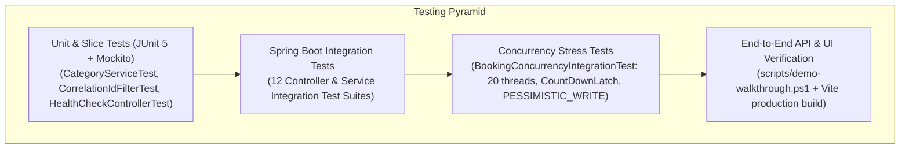

# Test Strategy & Verification Mapping Matrix

**Project:** Bussin' — Full-Stack Bus Ticket Booking Platform  
**Testing Frameworks:** JUnit 5, Mockito, Spring Boot Test (`@SpringBootTest`, `@AutoConfigureMockMvc`), Vite Build Verification  
**Acceptance Matrix Reference:** [`docs/acceptance-tests.md`](./acceptance-tests.md) (Tests **R01 – R20**)  

---

## 1. Test Level Architecture

---

## 2. Acceptance Test Mapping (R01 – R20)

> **Windows Execution Note:** Always pass `-DforkCount=0` on Windows PowerShell so JUnit 5 runs in-process without Maven Surefire forked-JVM stdout pipe blocks.

| Test ID | Test Title & Scope | Verification Level | Implemented Test Class(es) | Pass Criterion & Verified Assertions | Exact Windows Execution Command |
|---|---|---|---|---|---|
| **R01** | Admin Category CRUD & Reference-Safe Delete | Unit & Integration | `CategoryControllerIntegrationTest` (6 tests) `CategoryServiceTest` (8 tests) | Category created, updated; unreferenced deleted (`204`); referenced by bus returns `409 Conflict` and soft-deactivates. | `.\mvnw.cmd test -Dtest=CategoryControllerIntegrationTest,CategoryServiceTest -DforkCount=0` |
| **R02** | Bus CRUD, Auto Seat Layout & Constraints | Integration | `BusControllerIntegrationTest` (9 tests) | Bus registration uniqueness enforced; invalid category returns `404`/`400`; sequential 2x2 seater / 2x1 sleeper seats generated; referenced delete returns `409`. | `.\mvnw.cmd test -Dtest=BusControllerIntegrationTest -DforkCount=0` |
| **R03** | Station, Route & Trip Monotonicity + Mutex Rows | Integration | `StationControllerIntegrationTest` `RouteControllerIntegrationTest` (8 tests) `TripControllerIntegrationTest` (6 tests) | Ordered non-repeating route stops; strictly increasing trip stop times; `TripStopFare` and `TripSeat` mutex rows created for all seats; reference-safe trip delete (`409` + `CANCELLED`). | `.\mvnw.cmd test -Dtest=StationControllerIntegrationTest,RouteControllerIntegrationTest,TripControllerIntegrationTest -DforkCount=0` |
| **R04** | Customer Auth, Sessions, CSRF & RBAC | Integration | `AuthControllerTest` (8 tests) | BCrypt password hash in DB; HttpOnly `JSESSIONID` session cookie issued; customer blocked from `/api/v1/admin/**` (`403 Forbidden`). | `.\mvnw.cmd test -Dtest=AuthControllerTest -DforkCount=0` |
| **R05** | Direct Journey Search Filters & Segment Fares | Integration | `JourneySearchIntegrationTest` (7 tests) | Origin, destination, date, and `Asia/Kolkata` departure time window filtered accurately; intermediate stop pairs resolved; segment fare & available seats returned. | `.\mvnw.cmd test -Dtest=JourneySearchIntegrationTest -DforkCount=0` |
| **R06** | Partial-Route Disjoint Seat Resale | Integration | `BookingServiceIntegrationTest` (5 tests) | Passenger A books Stop `0 -> 1`; Passenger B books Stop `1 -> 3` for the exact same physical seat on the same trip. Both succeed (`[0,1)` and `[1,3)` are disjoint). | `.\mvnw.cmd test -Dtest=BookingServiceIntegrationTest -DforkCount=0` |
| **R07** | Overlapping Segment Rejection (`409 Conflict`) | Integration | `BookingServiceIntegrationTest` | Passenger A holds Stop `0 -> 2`. Passenger B requests overlapping Stop `1 -> 3` on the same seat. Request B is rejected with HTTP `409 Conflict`. | `.\mvnw.cmd test -Dtest=BookingServiceIntegrationTest -DforkCount=0` |
| **R08** | 20-Thread Concurrency Stress Test | Concurrency | `BookingConcurrencyIntegrationTest` (3 tests, 20 threads) | 20 parallel threads simultaneously book the same seat and segment using `CountDownLatch`. Exactly **1** succeeds, **19** fail with `409 Conflict`; DB has **1** active allocation. | `.\mvnw.cmd test -Dtest=BookingConcurrencyIntegrationTest -DforkCount=0` |
| **R09** | Connecting Journey Search Fallback | Integration | `ConnectingJourneySearchIntegrationTest` (5 tests) | When 0 direct trips match, returns 1-transfer itineraries with layover in `[30m, 480m]`; rejects tight (<30m) or excessive (>8h) connections. | `.\mvnw.cmd test -Dtest=ConnectingJourneySearchIntegrationTest -DforkCount=0` |
| **R10** | Multi-Leg Connecting Booking Atomicity | Integration | `BookingServiceIntegrationTest` | Leg 1 seat is free, Leg 2 seat has a conflict. Entire transaction rolls back cleanly; **0** active allocations remain on Leg 1. | `.\mvnw.cmd test -Dtest=BookingServiceIntegrationTest -DforkCount=0` |
| **R11** | Whole-Itinerary Cancellation & Seat Release | Integration | `BookingLifecycleIntegrationTest` (7 tests) | Owner cancels booking; status transitions to `CANCELLED`; all leg seat allocations are released for immediate rebooking; repeated cancel is idempotent. | `.\mvnw.cmd test -Dtest=BookingLifecycleIntegrationTest -DforkCount=0` |
| **R12** | Fare Snapshot Immutability | Integration | `BookingServiceIntegrationTest` | `BookingLeg.fareSnapshotInr` and `Booking.totalAmountInr` preserve exact `BigDecimal` fare at booking time regardless of subsequent schedule edits. | `.\mvnw.cmd test -Dtest=BookingServiceIntegrationTest -DforkCount=0` |
| **R13** | RFC 9457 `ProblemDetail` & MDC Request ID Tracing | Integration | `CorrelationIdFilterTest` (2 tests) `GlobalExceptionHandler` | Invalid inputs and domain conflicts return RFC 9457 `ProblemDetail` JSON with `X-Request-Id` header and zero leaked stack traces. | `.\mvnw.cmd test -Dtest=CorrelationIdFilterTest -DforkCount=0` |
| **R14** | Security & Booking Ownership Checks | Integration | `BookingLifecycleIntegrationTest` | Customer A attempting `GET /api/v1/bookings/{id}` or `POST /cancel` on Customer B's booking is rejected with `403 Forbidden`. | `.\mvnw.cmd test -Dtest=BookingLifecycleIntegrationTest -DforkCount=0` |
| **R15** | Relational Schema & Flyway / Seed Validation | Integration | `BusBookingApplicationTests` `V1__init_schema.sql`, `V2__seed_reference_data.sql` | Schema constraints, foreign keys, partial indexes, and seed data initialize cleanly without errors. | `.\mvnw.cmd test -Dtest=BusBookingApplicationTests -DforkCount=0` |
| **R16** | End-to-End Customer & Admin Flow | E2E / Script | `scripts/demo-walkthrough.ps1` `SeatMapModal.jsx`, Admin CRUD components | Complete flow: login, search, seat map inspection, atomic seat locking, ticket view, occupancy check, and cancellation. | `powershell -ExecutionPolicy Bypass -File .\scripts\demo-walkthrough.ps1` |
| **R17** | Responsive UI, Printable Ticket & Error States | Frontend Build | `PrintableTicket.jsx` (`@media print`), `AlertModal.jsx`, `JourneySearch.jsx` | Frontend compiles with zero errors; handles loading, empty states, `409` conflict alerts, and print stylesheet. | `cd frontend; npm run build` |
| **R18** | P1 Seat Hold Status Invariants | Integration | `SeatAllocation` (`HELD`, `holdExpiresAt`), `SeatAllocationRepository` | Active overlap queries respect both `CONFIRMED` and non-expired `HELD` allocations. | `.\mvnw.cmd test -Dtest=BookingServiceIntegrationTest -DforkCount=0` |
| **R19** | P1 Idempotency & Payment Schema | Integration | `BookingConcurrencyIntegrationTest` `BookingServiceIntegrationTest` | Duplicate booking requests carrying the same `Idempotency-Key` header return the existing booking without double-allocating or double-charging. | `.\mvnw.cmd test -Dtest=BookingConcurrencyIntegrationTest -DforkCount=0` |
| **R20** | Clean-Machine Windows Setup & Verification | Verification | `WINDOWS_SETUP.md`, `run-windows.ps1`, `scripts/verify-clean-setup.ps1` | One-click verification runs full backend test suite and frontend production build cleanly. | `powershell -ExecutionPolicy Bypass -File .\scripts\verify-clean-setup.ps1` |

---

## 3. Complete Inventory of Backend Test Classes (`src/test/java`)

1. [`AuthControllerTest.java`](../src/test/java/com/busbooking/auth/AuthControllerTest.java) — Registration, login, logout, session cookie, CSRF, and RBAC protection.
2. [`BookingConcurrencyIntegrationTest.java`](../src/test/java/com/busbooking/booking/BookingConcurrencyIntegrationTest.java) — 20-thread simultaneous single-seat contention, disjoint segment concurrency, and idempotency under load.
3. [`BookingLifecycleIntegrationTest.java`](../src/test/java/com/busbooking/booking/BookingLifecycleIntegrationTest.java) — Ticket retrieval, customer history, ownership enforcement (`403`), cancellation, and seat release.
4. [`BookingServiceIntegrationTest.java`](../src/test/java/com/busbooking/booking/BookingServiceIntegrationTest.java) — Direct booking, disjoint partial-route resale, overlap rejection (`409`), multi-leg atomic rollback, and fare snapshots.
5. [`BusBookingApplicationTests.java`](../src/test/java/com/busbooking/BusBookingApplicationTests.java) — Spring application context and schema bootstrap verification.
6. [`BusControllerIntegrationTest.java`](../src/test/java/com/busbooking/bus/BusControllerIntegrationTest.java) — Fleet CRUD, registration uniqueness, automatic seat grid generation, and reference-safe deletion.
7. [`CategoryControllerIntegrationTest.java`](../src/test/java/com/busbooking/category/CategoryControllerIntegrationTest.java) — Category CRUD, code uniqueness, and reference-safe soft-deactivation.
8. [`CategoryServiceTest.java`](../src/test/java/com/busbooking/category/CategoryServiceTest.java) — Fast Mockito unit tests for `CategoryService` domain logic.
9. [`ConnectingJourneySearchIntegrationTest.java`](../src/test/java/com/busbooking/journey/ConnectingJourneySearchIntegrationTest.java) — 1-transfer fallback search, `[30m, 480m]` layover window filtering, and cross-leg seat availability.
10. [`CorrelationIdFilterTest.java`](../src/test/java/com/busbooking/common/CorrelationIdFilterTest.java) — `X-Request-Id` propagation and MDC structured logging verification.
11. [`HealthCheckControllerTest.java`](../src/test/java/com/busbooking/common/HealthCheckControllerTest.java) — `/api/v1/health` readiness probe verification.
12. [`JourneySearchIntegrationTest.java`](../src/test/java/com/busbooking/journey/JourneySearchIntegrationTest.java) — Direct route search, intermediate stop matching, and IST time window filtering.
13. [`RouteControllerIntegrationTest.java`](../src/test/java/com/busbooking/route/RouteControllerIntegrationTest.java) — Route creation, ordered stop validation, non-repeating station constraint, and reference-safe deletion.
14. [`StationControllerIntegrationTest.java`](../src/test/java/com/busbooking/station/StationControllerIntegrationTest.java) — Station catalog CRUD and code uniqueness.
15. [`TripControllerIntegrationTest.java`](../src/test/java/com/busbooking/trip/TripControllerIntegrationTest.java) — Trip scheduling, stop timestamp monotonicity, `TripStopFare` matrix generation, `TripSeat` mutex population, and reference-safe trip cancellation/deletion.
